# RL-Based Vibration Control of a Flexible Robot Arm

**Design and implementation of a reinforcement-learning controller for a single-degree-of-freedom flexible link manipulator** — B.Sc. final project, Electrical Engineering (Control), Iran University of Science and Technology, July 2025.

The goal is to swing a 1 m flexible link to a target angle **and** suppress its tip vibration. The project doesn't use a hand-derived model with a PID loop. It is fully data-driven:

1. Real experiments with step, pulse and sine inputs → **520 logged runs** at 100 Hz
2. An **LSTM network** learns the arm's dynamics and becomes the simulator
3. A **Soft Actor-Critic (SAC)** agent learns the control policy inside that simulator
4. The learned voltage profile is applied to the **real arm** through a Raspberry Pi 4B

<p align="center">
  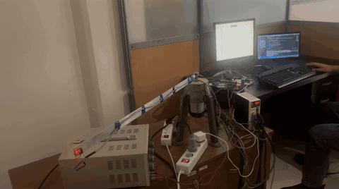<br>
  <em>The real arm running the SAC-generated voltage profile (<a href="media/robot_demo.mp4">full-quality video</a>)</em>
</p>

---

## Results

> **The finalized figures of the project are in the presentation:** [`docs/RL_Flexible_Arm_Presentation.pptx`](docs/RL_Flexible_Arm_Presentation.pptx). The plots below are taken from it.

| | |
|---|---|
| Target position | −30° |
| Final position, **real arm** (mean of last second) | **−29.84°** |
| Final position, simulation (training evaluation) | −29.69° |
| Strain-gauge rest offset / final value (simulation) | 2.400 V / 2.431 V |
| SAC training | 600 000 steps (~3 h) |
| Mean evaluation reward (10 episodes) | 133 019 ± 5 911 |

<p align="center">
  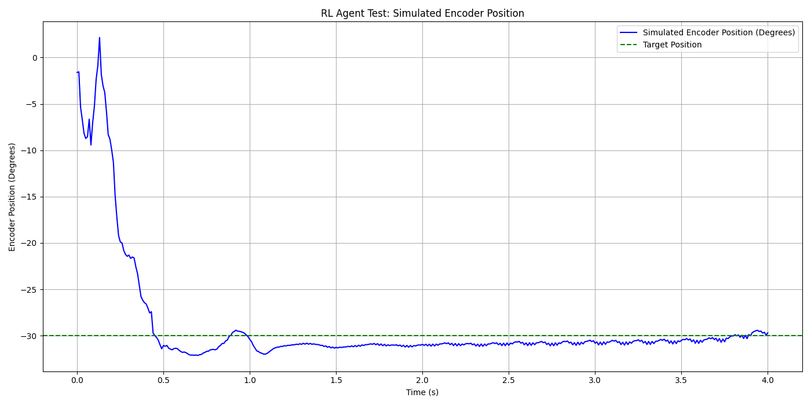
  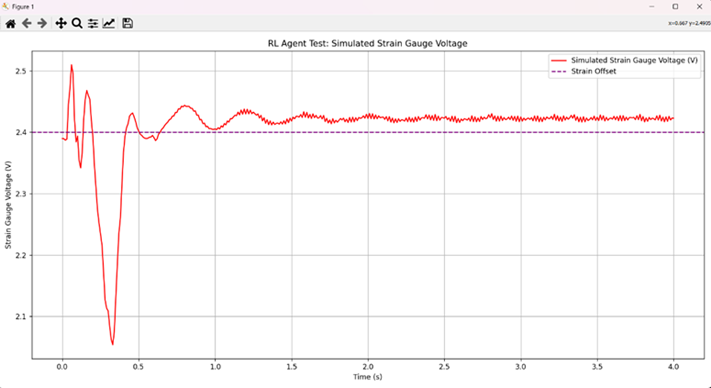
  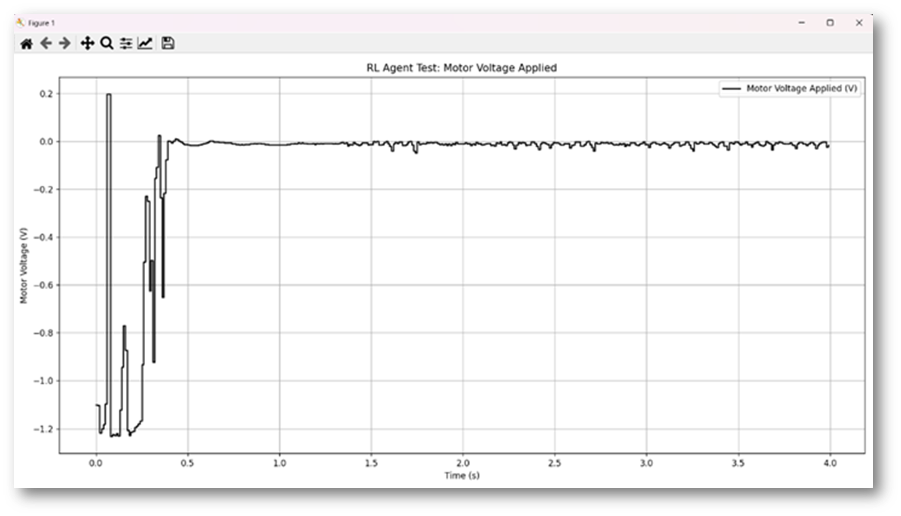
</p>
<p align="center"><em>SAC agent in the LSTM simulator: encoder position · strain-gauge voltage (tip vibration) · motor voltage</em></p>

The agent drives the link to the target in under a second. It then cancels the residual oscillation, so the strain-gauge signal settles back to its rest value while the motor voltage returns to ≈ 0 V.

### Simulation vs. real arm
The same voltage sequence was played on the physical arm (`experiments/`). The real arm settles at −29.8° after about 1.5 s, closely following the LSTM prediction. On the hardware, the strain-gauge signal is dominated by measurement noise (about ±0.2 V), so the damping is easier to judge from the video than from that trace.

<p align="center">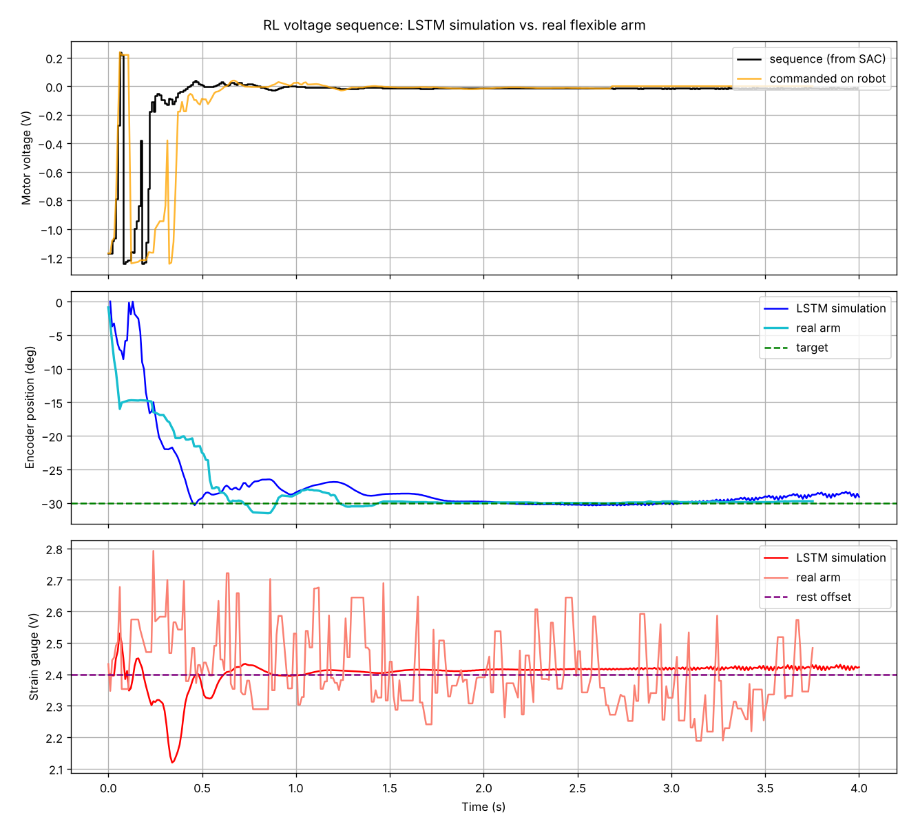</p>

---

## Hardware

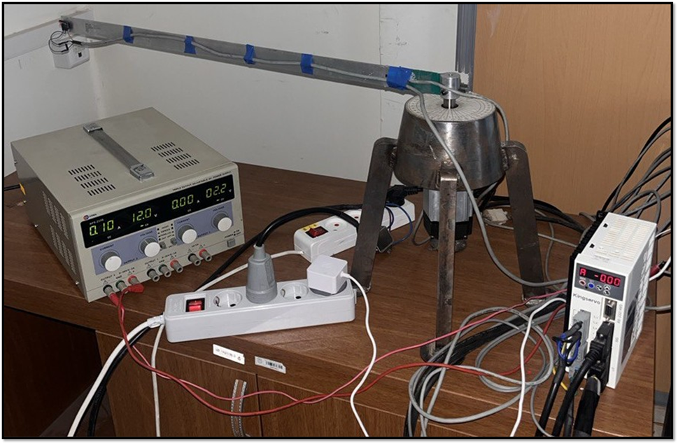

| Part | Details |
|---|---|
| Plant | 1-DOF flexible link (~100 cm), horizontal plane |
| Actuator | Servo motor + drive in torque-control mode |
| Position sensor | Incremental encoder (GPIO 17/27, 33 000 counts/rev) |
| Vibration sensor | Strain gauge on the link → ADS1115 16-bit ADC (I²C 0x49) |
| Command output | MCP4725 12-bit DAC (I²C 0x60), 0–5 V ↔ −1.25…+1.25 V motor command |
| Controller | Raspberry Pi 4B |

<br clear="right">

---

## Method

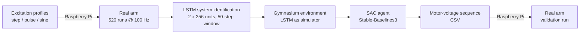

### 1. System identification with an LSTM
- **Input:** last 50 samples (0.5 s) of `[motor voltage, encoder angle, strain voltage]`
- **Output:** encoder angle and strain voltage at the next sample (10 ms ahead)
- 2 stacked LSTM layers (256 units) → dense 128 (ReLU) → 2 outputs. Standardised inputs and outputs, Adam, MSE loss, early stopping.
- Feeding predictions back into the window turns the network into a multi-step simulator. It reproduces the non-minimum-phase undershoot and the lightly damped link mode:

<p align="center">
  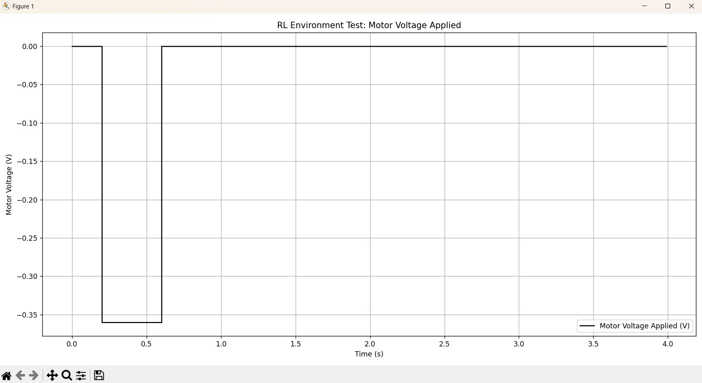
  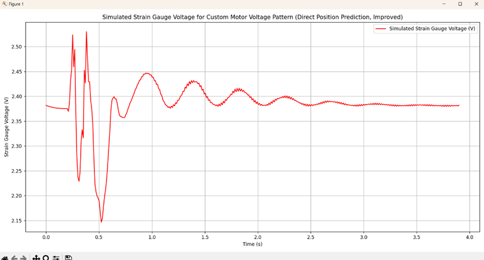
  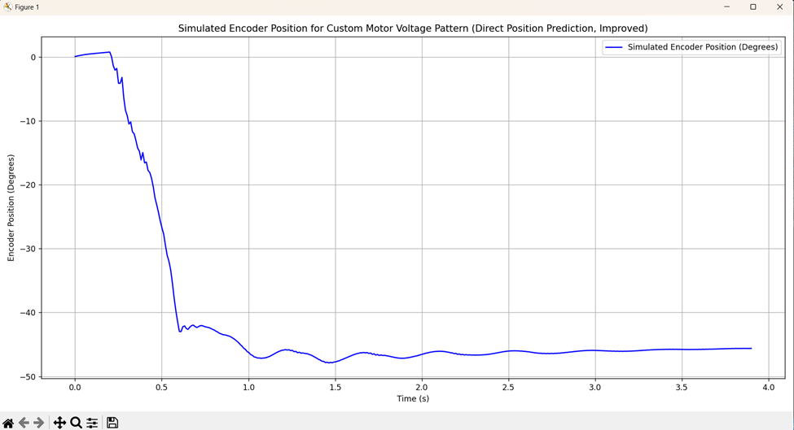
</p>

### 2. Reinforcement-learning environment
| | |
|---|---|
| Observation | angle, strain voltage, angle error to target, strain deviation from rest |
| Action | motor voltage ∈ [−1.25, 1.25] V |
| Episode | 400 steps (4 s at 100 Hz), random initial angle ±3° |
| Reward | −2·(angle error)² − 500·\|strain deviation\| − 60·V² + bonus for being within 5° **and** \|strain deviation\| < 0.1 V (larger when V ≈ 0) − 200 if the goal isn't reached at the end |

### 3. Soft Actor-Critic
Stable-Baselines3 SAC, MLP actor and critics `[256, 256]` with ReLU, lr 3e-4, γ = 0.99, τ = 0.005, batch size 256, replay buffer 100k, 600k timesteps. The best model is saved through `EvalCallback`.

<p align="center">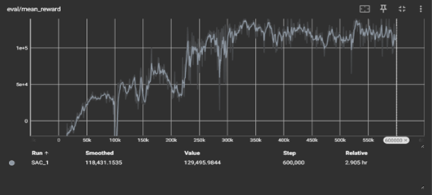</p>

### 4. Deployment on the real arm
The Raspberry Pi 4B couldn't run the LSTM + SAC policy in real time. So the trained agent is rolled out in the simulator from rest, and the resulting **voltage sequence is played back open-loop** on the arm while the encoder and strain gauge are logged at 100 Hz for comparison with the simulation.

---

## Repository structure

```
├── src/
│   ├── config.py                   # all paths & hyper-parameters in one place
│   ├── generate_excitation.py      # step 0 – step / pulse / sine profiles for data collection
│   ├── robot_lstm.py               # LSTM model + simulation helpers
│   ├── train_lstm_model.py         # step 1 – system identification
│   ├── robot_environment.py        # step 2 – Gymnasium environment
│   ├── train_sac_agent.py          # step 3 – SAC training
│   ├── export_action_sequence.py   # step 4 – policy → voltage CSV for the robot
│   └── compare_sim_vs_real.py      # step 5 – real-arm log vs. LSTM simulation
├── raspberry_pi/
│   ├── collect_pulse_runs.py       # original data-collection script (pulse experiments)
│   ├── run_on_robot.py             # plays a voltage CSV on the arm and logs the sensors
│   └── requirements.txt
├── data/runs/                      # 520 experimental runs (CSV, 100 Hz)
├── models/                         # trained LSTM, scalers and SAC agent used in the project
├── experiments/                    # voltage sequence sent to the arm + real-arm log
├── docs/                           # project presentation (PPTX) with the finalized figures
├── media/                          # figures and demo video
└── requirements.txt
```

## Getting started

```bash
git clone https://github.com/alihendi21/RL-controller-for-flexible-robot-arm.git
cd RL-controller-for-flexible-robot-arm
python -m venv .venv && source .venv/bin/activate      # Windows: .venv\Scripts\activate
pip install -r requirements.txt
```

**Try it without hardware (uses the included trained models):**
```bash
python src/compare_sim_vs_real.py             # real-arm log vs. LSTM simulation
python src/export_action_sequence.py          # roll out the trained SAC agent
```

**Retrain on a PC** (this overwrites the files in `models/`):
```bash
python src/train_lstm_model.py                # data/runs/ → models/robot_lstm_model.pth + scalers
python src/train_sac_agent.py                 # → models/final_robot_sac_agent.zip
python src/export_action_sequence.py          # → results/generated_action_sequence.csv
```

**On the Raspberry Pi (data collection & deployment):**
```bash
pip install -r raspberry_pi/requirements.txt   # enable I²C first (raspi-config)

# collect training data
python src/generate_excitation.py --count 30  # on the PC; copy data/excitation/*.csv to the Pi
python3 raspberry_pi/run_on_robot.py --input step_000.csv --output-prefix step_000 --no-plot

# run the learned controller
python3 raspberry_pi/run_on_robot.py --input generated_action_sequence.csv
```
The logs written by `run_on_robot.py` use the same columns as the training data, so you can drop them straight into `data/runs/`. `raspberry_pi/collect_pulse_runs.py` is the original script used for the pulse experiments.

> ⚠️ Keep a hand on the drive's emergency stop the first time you play a new sequence. On exit, the script always sets the DAC to mid-scale (0 V motor command).

## Limitations & next steps
- **Open-loop deployment.** The policy is learned closed-loop, but on the hardware a precomputed sequence is replayed, so there's no correction for disturbances or model mismatch. Next steps: export the actor to ONNX/TorchScript (the actor alone is a small MLP that the Pi can evaluate at 100 Hz) and close the loop with live encoder/strain feedback.
- **Sim-to-real gap.** The policy is only as good as the LSTM simulator. Domain randomisation or fine-tuning on real rollouts would make it more robust.

## Authors
- **Seyed Ali Hendi**
- **Ali Fathabadi**

Supervisor: **Dr. Seyed Majid Esmailzadeh**, School of Electrical Engineering, Iran University of Science and Technology.

## License
Released under the [MIT License](LICENSE).
